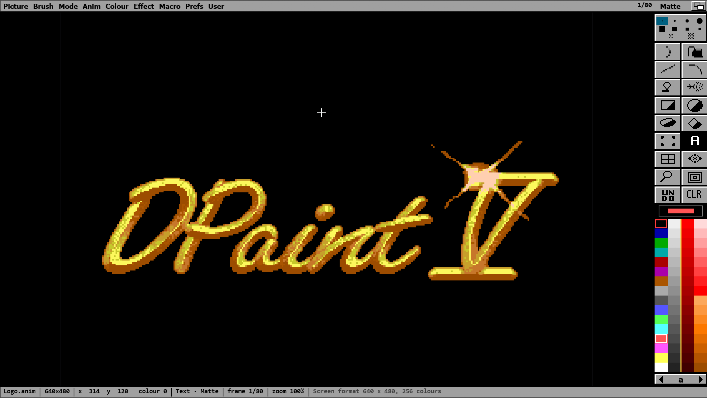
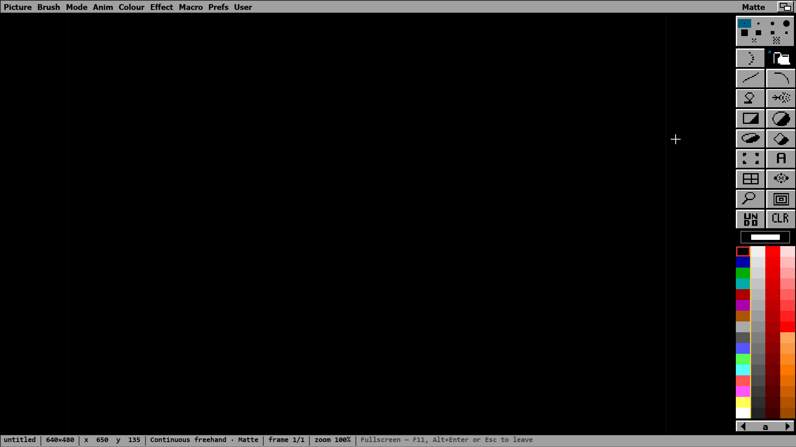
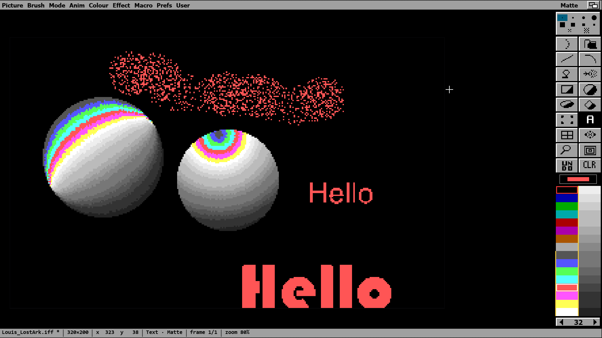
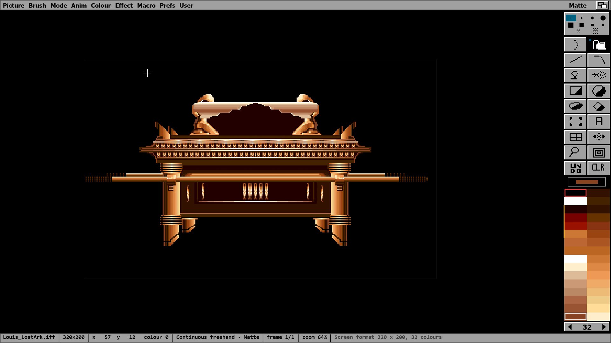

# Deluxe Pixel

🇬🇧 English | [🇩🇪 Deutsch](#deutsch)



## English

**Deluxe Pixel** is a clone of **DPaint 5.2** (Deluxe Paint), the classic pixel paint program from the Amiga era. It is a modern Windows pixel paint program written in Rust, in the spirit of the classic 256-colour paint programs.

> This is an independent, fan-made project. It is not affiliated with or endorsed by the makers of DPaint or Deluxe Paint.

### Screenshots







### Build & run

Requirements: [Rust](https://rustup.rs/) (stable) on Windows.

```sh
cd app
cargo run --release
```

The release binary is created at `app/target/release/deluxe-pixel.exe`.

### License

Released under the [MIT License](LICENSE).

---

## Deutsch

**Deluxe Pixel** ist ein Klon von **DPaint 5.2** (Deluxe Paint), dem klassischen Pixel-Malprogramm aus der Amiga-Ära. Es ist ein modernes Pixel-Malprogramm für Windows, geschrieben in Rust, im Geiste der klassischen 256-Farben-Malprogramme.

> Dies ist ein unabhängiges Fan-Projekt. Es steht in keiner Verbindung zu den Machern von DPaint bzw. Deluxe Paint und wird von ihnen nicht unterstützt.

### Screenshots


### Bauen & starten

Voraussetzung: [Rust](https://rustup.rs/) (stable) unter Windows.

```sh
cd app
cargo run --release
```

Die fertige Programmdatei liegt unter `app/target/release/deluxe-pixel.exe`.

### Lizenz

Veröffentlicht unter der [MIT-Lizenz](LICENSE).
